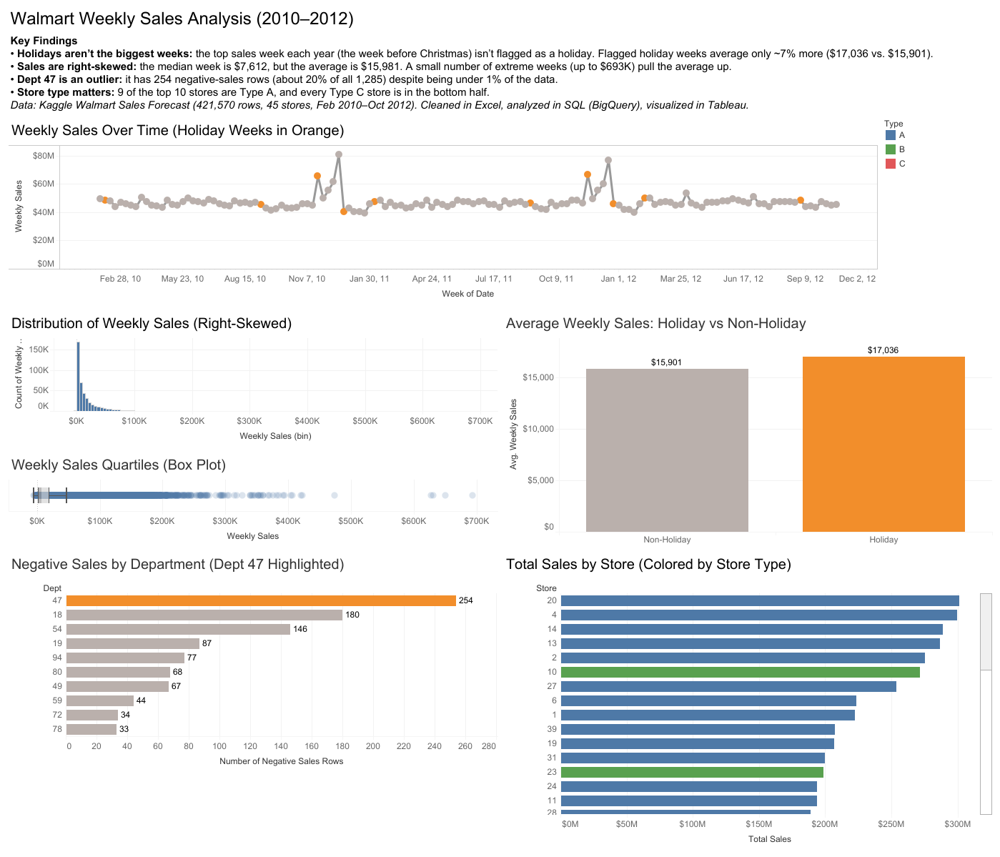

# Walmart Weekly Sales Analysis (2010–2012)

I chose this as an end-to-end practice project analyzing Walmart's weekly sales across 45 stores from 2010 to 2012. I cleaned and organized the data in Excel, analyzed it with SQL in BigQuery, and visualized the results in Tableau. It was a test of my knowledge and a practical way to sharpen my growing skills.

**[View the interactive dashboard on Tableau Public](https://public.tableau.com/app/profile/joseph.passo/viz/Walmart_Sales_Analysis_17944476998540/WalmartSalesDashboard)**

## Questions I Set Out to Answer
- Are sales flat throughout the year, spiking only during holidays?
- Are there large differences in sales between stores?
- Why do some weeks show negative sales, and where do they come from?
- What does a "typical" sales week actually look like?

## Data
- **Source:** [Walmart Sales Forecast on Kaggle](https://www.kaggle.com/datasets/aslanahmedov/walmart-sales-forecast)
- **Size:** 421,570 weekly sales records across 45 stores and their departments, Feb 2010 – Oct 2012
- **Files used:** train.csv (weekly sales), stores.csv (store type and size)

## Tools & Process
1. **Excel** – Checked for blank cells and missing values (none found). While reviewing sales figures, I discovered negative Weekly_Sales values and measured how many there were (1,285 rows). Calculated the average, median, and quartiles, which showed the data is heavily right-skewed, and compared holiday vs. non-holiday averages. Used VLOOKUP to pull each store's type and size from stores.csv into the sales data, and counted how many departments each store carries.
2. **BigQuery (SQL)** – Re-ran my Excel analysis in SQL to validate the findings and confirm both tools produced the same results. Used a JOIN between train.csv and stores.csv to calculate average weekly sales by store type. Queries: [walmart_sales_queries.sql](walmart_sales_queries.sql)
3. **Tableau Public** – Built six charts and combined them into an interactive dashboard to present the findings visually:
   - Weekly sales over time, with holiday weeks highlighted
   - Distribution of weekly sales (histogram) and quartiles (box plot), showing the right skew
   - Average sales: holiday vs. non-holiday weeks
   - Negative sales by department, with Dept 47 highlighted
   - Total sales by store, colored by store type

## Data Cleaning Decisions
- **Negative sales:** 1,285 rows (~0.3%) had negative Weekly_Sales. Rather than delete them, I flagged them. They likely reflect real events such as returns, not data errors, and removing them would make sales look better than they actually were. Negative weeks are also worth keeping visible: if they trend upward quarter after quarter, a small "slow bleed" can become a major loss, and catching it early depends on being able to identify and analyze it.
- **Dates:** Each date represents the Friday that ends that week. The holiday flag marks the week containing the holiday itself, so the heavy Christmas-shopping weeks before December 25 are not flagged.

## Key Findings
1. **The holiday boost is concentrated, not universal.** On average, flagged holiday weeks are only ~7% higher ($17,036 vs. $15,901). But the boost is concentrated: the five biggest store-department weeks in the dataset all fall on Thanksgiving week, all in Dept 72, at just two stores (10 and 35). Meanwhile, the biggest chain-wide weeks are the weeks *before* Christmas, which aren't flagged as holidays at all. The holiday flag alone doesn't capture when or where customers actually spend.
2. **Sales are right-skewed.** The median week is $7,612, but the average is $15,981, pulled up by a small number of massive weeks (up to $693,099, about 34 times the 75th percentile of $20,206). The very largest weeks follow a clear pattern: the top five all come from Dept 72 at just two stores (10 and 35), and all fall in Thanksgiving week. That makes the biggest spikes predictable, at least within this 2010–2012 time frame.
3. **Dept 47 is an outlier.** It has 254 negative-sales weeks out of 646 (39%), accounting for ~20% of all negative rows despite being under 1% of the data, and it averages -$7.68 per week. It appears in 37 of 45 stores, so it isn't a one-store issue. Department names aren't included in the dataset, but the pattern suggests a returns or adjustments-related category. Since 61% of its weeks are still positive, it's likely a mix rather than returns alone.
4. **Store type matters.** 9 of the top 10 stores by total sales are Type A, and every Type C store falls in the bottom half. Type A stores are also the largest on average (177,248 vs. 101,191 for Type B and 40,542 for Type C, from the Size column in stores.csv), so store size is likely at least a partial driver of higher sales. Some Type B stores are also large, though, and size alone doesn't prove cause, since location, customer traffic, and department mix could also play a role.

## What I'd Do Next
- Dig deeper into Dept 47 to find out why it's an outlier, including joining features.csv to see whether markdowns (discounts) line up with its negative-sales weeks.
- Investigate the extreme high-sales weeks behind the right skew, such as which stores, departments, and time periods drive them, since those weeks explain the gap between the median and average week.

## About Me
I spent over 11 years in the American Red Cross Bio-Medical Division, where I specialized in data entry, compliance, and FDA audit preparation. I earned the Google Data Analytics Professional Certificate in May 2026, and I'm now completing an MBA in Finance while transitioning into data analytics, using Excel, SQL, and Tableau to clean, analyze, and present data that helps organizations make informed decisions and uncover what's really driving their results. I'm targeting roles in financial, healthcare, and compliance analytics.

---
*All data cleaning, SQL queries, and Tableau visualizations were completed by me. README editing was assisted by Claude (Anthropic).*
